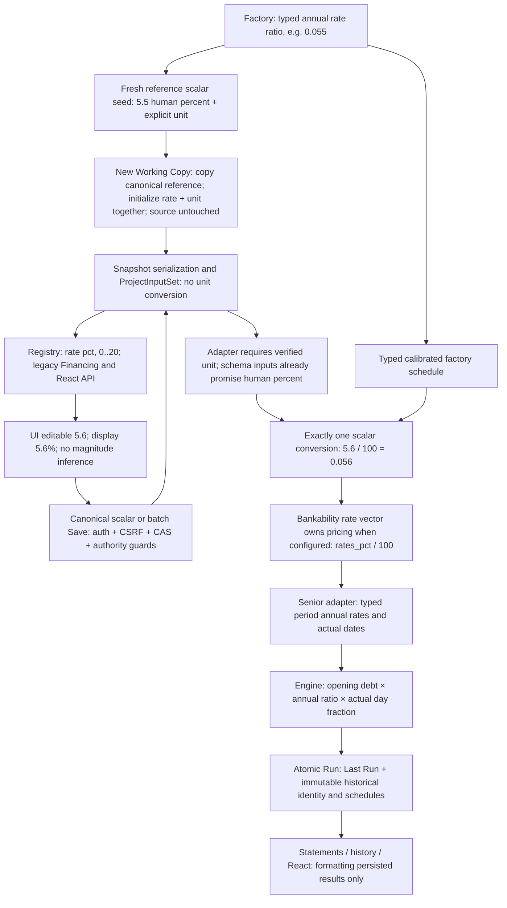

# FIN-VAL F01 — root cause

Base main `6f10f3927b33a5715ac6313da200d0f96c023524`, tree `62e70c3bfda7a91280c8c16acc89eeef9f780d6b`. Live main/PR/check provenance is in `evidence/preflight.json`. PRs #383/#384/#385 were merged; the mandatory baseline checks were successful (the unused sequential job was skipped). Existing open performance PRs were not integrated. Branch: `fix/finval-p0-rate-contract`; no rebase, squash, cherry-pick or force push.

Both audits were analyzed before source edits. The React ZIP exceeds the attachment transfer cap; the exact locally generated original audit package from this conversation was read instead. Its original F01 typed-rate and browser Save/reload evidence corroborates, but does not replace, independent regression. The Model audit's timing, financing, sponsor semantics, acceptance gaps and owner registers were reviewed. Their recommendations are not release authorization.

## Independent reproduction

Before implementation, the new rate regression produced **9 failures / 4 passes**: four reference scalar baselines used decimal ratios where the registry promises human percent; `0.055` was treated as a factory-equivalent 5.5% by the dual-format resolver; the projection multiplied genuine sub-1% rates. See `evidence/baseline-rate.xml`.

Three interacting defects:

1. `projects_repository._compute_baseline_snapshot` serialized `base_rate + margin_bps/10000` as `interest_rate_pct`. That quantity is a ratio.
2. `_resolve_user_inputs` skipped a scalar override when EITHER raw value or raw/100 approximately matched the factory ratio. Thus 0.055 could mean 5.5%, while 0.056 meant 0.056%. This was unit inference by factory coincidence, not a stable contract.
3. `_build_sheet_fields` multiplied percentage numbers with absolute magnitude below 1 for display. Saving 0.056 produced a typed rate of 0.00056 but a formatted label of 5.60%.

The engine's interest equation was not the root cause. `_set_financing_interest_rate` already divided human percentages by 100. Repairing that division or multiplying values in React would introduce a new error.

## Complete authority flow

The exact-flat identity fast path preserves the existing typed object when the human percentage equals typed ratio ×100 exactly. It does not accept a decimal ratio as an alternative scalar representation and has no tolerance-based unit guess.

## Boundary inventory

| Boundary | Unit / authority |
|---|---|
| Factory base_rate | Decimal ratio |
| Factory margin_bps | Basis points; divide by 10000 only for combining rates |
| New canonical scalar seed / new copy | Human percentage, marker `_finval_interest_rate_unit=human_percent_v1` |
| Legacy V2 and React canonical Save | Same semantic pct field and writer; marker/value retained in one atomic snapshot |
| ProjectInputSet | Typed scalar numeric value; snapshot provenance preserved |
| Adapter scalar setter | Human percentage → ratio exactly once |
| Explicit typed senior schedule | Ratios; non-flat calibrated schedule preserved |
| Bankability config rates_pct | Human percentage vector; exclusive authority, existing conversion preserved |
| Engine | Typed ratio; ACT/360 or ACT/365 day fraction |
| Persisted Run | Immutable identity and computed evidence; never reinterpreted through current scalar assumptions |

## Old paths and historical records

Unversioned snapshots are not guessed from value, template name or closeness to a default. Saved materialization raises `INTEREST_RATE_UNIT_UNVERIFIED`; the React field projection marks the scalar read-only with an unverified-unit explanation. No factory substitution or migration is introduced.

`main_web._project_baseline_snapshot` is an additional legacy producer of unversioned ratio-like scalars. It is outside the five authorized application paths and is **not changed**. Its saved snapshots require a separately authorized producer/provenance correction before release. The isolated V2 legacy form over corrected Working Copies is tested separately from that older creation path.

This deliberate compatibility boundary is an activation blocker. Do not deploy the candidate into an existing database without an explicit historical-record and producer disposition.

## Construction financing and actual pricing consumption

H-1 `financial_engine/financing/generic_product_policy.py` derives construction all-in pricing from the first explicit typed senior rate when available, then from the explicit flat mode, and only then the declared legacy all-in value. Explicit construction-financing inputs remain authoritative. The corrected scalar therefore reaches the existing senior schedule and the policy's typed construction pricing path; no IDC formula or pricing-policy rewrite is introduced. The independent period-interest evidence verifies actual engine consumption rather than only API/display agreement.
